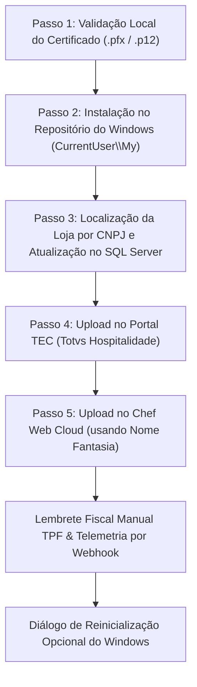

# CONTEXTO E BRIEFING DO PROJETO: TOTVS Cert Uploader

Este documento consolida todo o histórico, decisões arquiteturais, alterações realizadas e o estado atual do projeto **TOTVS Cert Uploader**. Ele foi estruturado para ser utilizado como **prompt de contexto** para qualquer inteligência artificial ou desenvolvedor dar continuidade ao projeto sem perda de informações.

---

## 📌 Identificação do Projeto
- **Nome:** TOTVS Cert Uploader
- **Repositório GitHub:** `git@github.com:faustosoftbr/Totvs_cert_uploader.git`
- **Diretório Local:** `/home/fausto/.gemini/antigravity/scratch/Totvs_cert_uploader`
- **Versão Atual:** `v4.0.0`
- **Linguagem & Stack:** Python 3.12 (`customtkinter`, `playwright`, `cryptography`, `pyodbc`, `requests`, `pyinstaller`).

---

## 🎯 Objetivo e Propósito do Aplicativo
O **TOTVS Cert Uploader** é uma aplicação desktop desenvolvida para automatizar a troca periódica de Certificados Digitais A1 (formato `.pfx` ou `.p12`) no ecossistema de software fiscal do **TOTVS Chef**.

### Por que um aplicativo desktop (executável) em vez de nuvem?
1. Conexão direta TCP na porta 1433 com a base SQL Server local (`localhost\SQLEXPRESS` / banco `MISTERCHEFNET`).
2. Instalação do certificado no repositório do Windows (`Cert:\CurrentUser\My`) com chave privada marcada como exportável (`-Exportable`) via comandos nativos de sistema (PowerShell).
3. Automação segura com navegadores locais sem limitações de CORS, sandboxing ou cookies de terceiros.

---

## 🔄 Pipeline de Execução (Arquitetura v4.0.0)

O aplicativo executa as seguintes etapas orquestradas em segundo plano por thread desacoplada:



### Detalhamento das Etapas:
1. **Passo 1 — Validação do Certificado (`cert_manager.py`)**:
   - Lê o arquivo `.pfx` com a senha informada usando `cryptography`.
   - Extrai Razão Social, CNPJ numérico, período de vigência e dias restantes.
   - Formata a string canônica do `Subject DN` na ordem esperada pelo Totvs Chef (`CN... OU... L... S... O... C...`).

2. **Passo 2 — Instalação no Windows Store (`cert_manager.py`)**:
   - *Antecipado para o Passo 2 na v4.0.0*: Garante que o Windows conheça o certificado com chave privada exportável antes de qualquer sincronização externa.
   - Executa script PowerShell seguro chamando `Import-PfxCertificate` em `Cert:\CurrentUser\My`.

3. **Passo 3 — Localização Dinâmica por CNPJ e Atualização do SQL (`db_service.py`)**:
   - *Modificado na v4.0.0*: **Não fixa mais na Loja 1**.
   - Consulta todas as lojas em `[MISTERCHEFNET].[dbo].[Lojas]`, limpa pontuações de CNPJ com regex (`\D`) e localiza a loja correspondente ao certificado.
   - Atualiza o campo `[NomeCertificado]` especificamente para o `[Código Loja]` identificado.
   - Extrai o **Nome Fantasia** (`loja.nome_loja`) e **CNPJ** para uso nos passos seguintes.
   - Verifica se a loja utiliza módulo NF-e consultando a tabela `[NFe_Item]` (últimos 60 dias).

4. **Passo 4 — Upload no Portal TEC (`totvs_tec.py`)**:
   - Automação Playwright em segundo plano.
   - Efetua login com credenciais de parceiro configuradas no `.env`.
   - Busca a empresa pelo CNPJ da loja identificada e anexa o arquivo do certificado e senha.

5. **Passo 5 — Upload no Chef Web Cloud (`totvs_chef_web.py`)**:
   - Automação Playwright na nuvem Totvs Chef.
   - Localiza a filial pelo **Nome Fantasia** da loja selecionada no Passo 3.
   - Navega para *Cadastros > Loja > Aba Recepção NF-e*, faz o upload do PFX e salva.

6. **Lembrete Fiscal Manual TPF (`app.py`)**:
   - O upload automático na plataforma TPF foi descontinuado. Em vez disso, se a loja emite NF-e, o sistema registra um alerta obrigatório nos logs e na tela final com link direto para o portal `https://plataformafiscal.totvs.com.br/estabelecimento`.

7. **Telemetria e Auditoria (`logger_service.py` & `gas_webhook.js`)**:
   - Grava logs locais e envia o relatório completo da operação por e-mail via Webhook do Google Apps Script.

8. **Reinicialização do Sistema (`reboot_service.py`)**:
   - Exibe mensagem amigável perguntando se o cliente deseja reiniciar o computador para carregar os novos certificados nos serviços do Windows.

---

## 📂 Estrutura dos Arquivos Principais

- [`app.py`](app.py): Interface desktop em CustomTkinter e orquestração do pipeline de passos 1 a 5.
- [`cert_manager.py`](cert_manager.py): Decodificação PKCS#12, validação de datas, extração de CNPJ e comandos PowerShell de importação.
- [`db_service.py`](db_service.py): Comunicação ODBC com o SQL Server local (`consultar_todas_lojas`, `buscar_loja_por_cnpj`, `atualizar_certificado_loja`). Contém tolerância a ambientes Linux sem driver ODBC.
- [`totvs_tec.py`](totvs_tec.py): Script de automação Playwright para o Portal TEC.
- [`totvs_chef_web.py`](totvs_chef_web.py): Script de automação Playwright para o Chef Web Cloud.
- [`secrets_manager.py`](secrets_manager.py): Leitura e escrita segura de senhas no arquivo `.env` local, com CLI interativa mascarada.
- [`logger_service.py`](logger_service.py): Formatação de logs e despacho via Webhook.
- [`reboot_service.py`](reboot_service.py): Execução do comando de shutdown/reinício no Windows.
- [`test_suite.py`](test_suite.py): Bateria com 7 testes unitários automatizados cobrindo todas as regras críticas.
- [`TOTVS-Cert-Uploader.spec`](TOTVS-Cert-Uploader.spec): Arquivo de especificação para compilação com PyInstaller.
- [`RELEASE_NOTES.md`](RELEASE_NOTES.md): Descrição oficial e notas de lançamento da versão 4.0.0.
- [`.github/workflows/build-release.yml`](.github/workflows/build-release.yml): Pipeline de CI/CD que compila automaticamente o executável Windows (`TOTVS-Cert-Uploader.exe`) em runner `windows-latest` ao disparar tags `v*`.
- Scripts auxiliares:
  - Windows: `iniciar.bat`, `gerar_exe.bat`, `enviar_github.bat`, `instalar_hook_seguranca.bat`.
  - Linux: `run.sh`, `enviar_github.sh`.

---

## 🔒 Regras de Segurança e Boas Práticas

1. **Credenciais no `.env`**:
   - As credenciais ficam exclusivamente em `.env` local (`TEC_USER`, `TEC_PASSWORD`, `CHEFWEB_USER`, `CHEFWEB_PASSWORD`, `SQL_USER`, `SQL_PASSWORD`, `GAS_WEBHOOK_URL`).
   - `.env` e certificados (`*.pfx`, `*.p12`, `*.key`) estão estritamente ignorados pelo `.gitignore`.
2. **Hook Pré-Commit**:
   - Ativo em `.git/hooks/pre-commit` para impedir submissão acidental de certificados, `.env` ou senhas em texto puro.
3. **Autenticação Git**:
   - Configurada via chave SSH (`git@github.com:faustosoftbr/Totvs_cert_uploader.git`), sem tokens expostos em arquivos de configuração.

---

## 🚀 Como Retomar ou Adicionar Funcionalidades

### Rodar a Bateria de Testes:
```bash
python test_suite.py
```

### Iniciar o Aplicativo:
- **No Linux:** `./run.sh`
- **No Windows:** dois cliques em `iniciar.bat`

### Gerar Nova Versão do Executável (.exe):
1. **Pelo GitHub Actions (Recomendado):**
   - Atualize `APP_VERSION` em `app.py`, `README.md` e `RELEASE_NOTES.md`.
   - Crie e envie a tag:
     ```bash
     git tag -a v4.X.X -m "Release v4.X.X"
     git push origin main --tags
     ```
   - O GitHub Actions compilará em uma VM Windows e anexará o `.exe` diretamente na aba **Releases** do repositório.
2. **Localmente no Windows:**
   - Execute `gerar_exe.bat` (gera o binário em `dist\TOTVS-Cert-Uploader.exe`).
